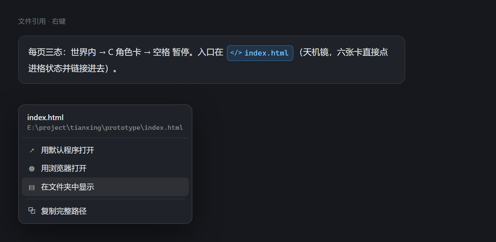
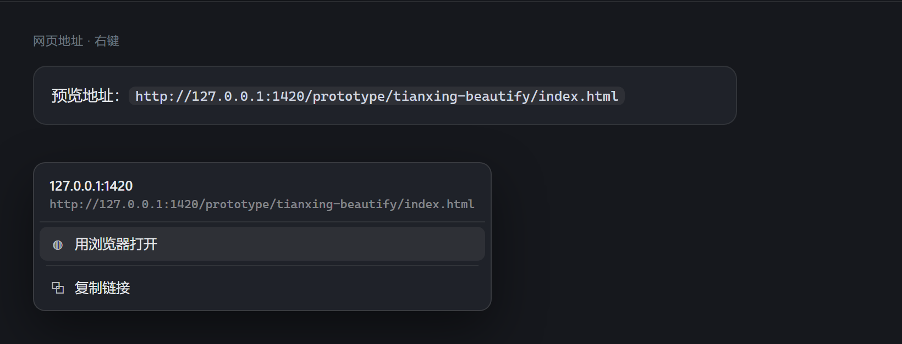

# dsh-file-actions

给 DeepSeek Harness Web 界面里的文件引用加右键菜单。

Right-click menu for file references in the DeepSeek Harness web UI.

[](LICENSE)
[](https://github.com/deepseek-ai/deepseek-harness)
[](https://github.com/topics/dsh-plugin)

> 装不上、报错、或者行为和文档对不上，直接发邮件到 **1992335297@qq.com**，比开 Issue 更快被看到。

---



## 它解决什么问题 / The problem

DSH 会把消息里的文件引用渲染成蓝色 chip，例如 `index.html`、`@src/app.tsx`。它们看起来像可以点的链接，实际只能看，想打开文件还得手动去资源管理器里翻。

`dsh-file-actions` 让这些引用支持右键：直接打开文件、在资源管理器里定位、用浏览器预览、复制完整路径。

DSH renders file mentions as blue chips (`index.html`, `@src/app.tsx`). They look clickable but are not. This plugin adds a context menu so you can open the file, reveal it in Explorer, preview it in a browser, or copy its absolute path.

## 功能 / Features

| 菜单项 | 适用文件 | 行为 |
|---|---|---|
| 用默认程序打开 | 全部 | 交给 Windows 文件关联 |
| 用浏览器打开 | html / svg / md / txt / json / xml / yaml / css / js / ts 等文本类 | 以 `file:///` URL 交给默认浏览器 |
| 在文件夹中显示 | 全部 | 打开资源管理器并选中该文件 |
| 复制完整路径 | 全部 | 写入剪贴板 |

菜单头部显示文件名与完整路径，长路径左侧渐隐，方便确认打开的是哪一个。

以下这些引用形态都能识别：

- `[data-ref-chip]` 元素（DSH 渲染的蓝色文件 chip），`file` / `folder` / `skill` 三种都认
- 任何 `title` 属性里写着完整路径的元素（chip 的 `title` 被裁掉时用这条兜底）
- `file:///` 形式的链接
- 行内代码、键名与示例文本（`code` / `kbd` / `samp`）
- 元素内容整串就是一个路径（最后兜底）

被引用的是网页地址（`http://` / `https://`）时，菜单换成网址专用：**用浏览器打开**、**复制链接**。网页地址不会被当成本地路径去定位。



> 两张图是界面示意，按插件 `lib/client.js` 里同一套菜单样式与 DSH 消息区样式渲染，不是运行截图。可用 `node scripts/make-screenshots.mjs` 重新生成（源码在 `scripts/demo/menus.html`）。

### 右侧栏文档预览

右侧栏打开文件预览时，标签头部会多出一个 **▤ 定位** 按钮，直接在当前文档所在的文件夹里选中它。

它注册在 `sidebar.right.tab.document.actions` 插槽上，拿到的是当前文档的 `absolutePath`——官方为这类操作预留的接缝，不需要拦截或改写预览组件。

## 更新记录

- **0.1.2** — 修好两类「蓝色文件右键没反应」：`data-ref-chip="skill"` 的引用之前被整体跳过，现在照常当文件处理；以 `/` 结尾的目录路径匹配不上正则，现在能认。识别范围扩到 `title` 属性、`kbd`/`samp` 与整串路径元素。新增右侧栏文档预览头部的「定位」按钮。新增 `scripts/dom-test.mjs`，在真实 Chromium 里跑 14 项 DOM 回归。
- **0.1.1** — 修复网页地址被误当作相对路径解析、报 `path does not exist` 的问题；新增网址专用菜单与 `open-url` 动作（只放行 http/https，拒绝含双引号的地址）。自检改为真实加载客户端模块，去掉 `new Function`，用例从 12 项增至 17 项。
- **0.1.0** — 首个版本。

## 安装 / Install

### 一条命令

```bash
dsh plugin --profile desktop add "github:nubeslove/dsh-file-actions"
```

随后在 `$DSH_HOME/profiles/desktop/package.json` 的 `dsh.profile.bundles` 里追加 `"dsh-file-actions"`，重启桌面应用。插件是纯 JS，没有构建步骤，也没有运行时依赖。

### 本地开发：手工 link（路径含空格时）

1. 在 `profiles/<profile>/package.json` 的 `dependencies` 加一条：
   ```json
   "dsh-file-actions": "link:E:/path/to/dsh-file-actions"
   ```
2. 在 `dsh.profile.bundles` 追加 `"dsh-file-actions"`。
3. 在 `profiles/<profile>/node_modules/` 下建一个指向本目录的目录联接（Junction）：
   ```powershell
   New-Item -ItemType Junction -Path "<profile>/node_modules/dsh-file-actions" -Target "E:\path\to\dsh-file-actions"
   ```
4. 重启 DSH 桌面应用。

`$DSH_HOME` 默认是 `~/.dsh`。桌面端使用 `desktop` profile，纯 Web 端使用 `web` profile。

### 卸载

删掉 `node_modules/dsh-file-actions` 与 `bundles` 里的那一行即可。插件不修改任何既有文件。

## 权限与安全边界 / Permissions & safety

这是一个**会执行本机命令**的插件，装之前请明确知道它做了什么。

- **三个动作，白名单**：`reveal` / `open` / `browser`。接口不接受任意命令字符串。
- **路径必须真实存在**：宿主在执行前做 `existsSync` 与 `stat` 校验，不存在的路径直接返回 400。
- **不做 shell 字符串拼接**：全部通过 `spawn` 的参数数组传递，路径不会被当作命令解释。
- **不读文件内容**：宿主只做定位与打开，不读取、不上传任何文件正文。
- **无外部网络请求**：客户端只向同源的 `/api/file-actions/exec` 发 POST。
- **无依赖**：`dependencies` 为空，没有生命周期脚本（`preinstall` / `install` / `postinstall` / `prepare` 都不存在）。

This plugin spawns local Windows processes. It exposes exactly three whitelisted actions, validates that the target path exists, passes arguments as arrays (never shell-interpolated strings), never reads file contents, and makes no outbound network requests.

## 兼容性 / Compatibility

- 在 DeepSeek Harness `0.1.1-rc.2` + Windows 上开发与验证。
- 依赖 DSH 把文件引用渲染为 `[data-ref-chip]`、`file://` 链接或 `code` 元素。三者任一变体都可识别；若上游渲染结构整体更换，右键会失效，需要在 `lib/client.js` 的 `resolveFromEvent` 里补选择器。
- 系统动作部分使用 Windows 的 `explorer.exe` 与 `cmd.exe /c start`，其他平台需要替换 `lib/index.js` 里的 `launch` 调用。

## 已知限制 / Known limitations

- 相对路径引用（如 `index.html`）按宿主进程当前工作目录解析，解析不到会提示 `path does not exist`。
- 菜单样式跟随 DSH 设计 token，深浅色主题自动适配。
- 未做键盘全流程导航（Esc 关闭已实现，方向键在菜单项间移动尚未实现）。
- 系统动作（真的弹出资源管理器/浏览器）没有自动化测试覆盖，需要人工点一次确认。

## 开发 / Development

```
lib/index.js         宿主侧：注册 /api/file-actions 路由，执行系统动作
lib/client.js        客户端侧：捕获 contextmenu，识别引用，渲染菜单
scripts/verify.mjs   自检
```

自检：

```bash
node scripts/verify.mjs
```

覆盖包元数据、客户端语法、路由注册、健康检查，以及未知动作 / 不存在路径 / 空路径 / 非法路由四个拒绝分支。共 12 项。

健康检查接口：

```
GET /api/file-actions/health
```

## 许可证 / License

[MIT](LICENSE)

---

如果这个插件帮你省了几次在资源管理器里翻文件的时间，点个 Star 会让更多人看到它。

## 反馈与联系 / Feedback & Contact

遇到 bug、安装失败、行为和文档不一致，或者想要某个功能，都可以直接发邮件。

**邮箱：1992335297@qq.com**

邮件里带上这三样，定位会快很多：

- 插件版本（`package.json` 里的 `version`）
- DSH 版本（`dsh --version`）
- 报错的完整文字或截图

也可以在 [GitHub Issues](https://github.com/nubeslove/dsh-file-actions/issues) 提，但邮件更快。
